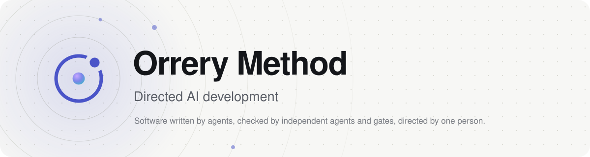

  <picture>
    <source media="(prefers-color-scheme: dark)" srcset="docs/brand/banner-dark.svg">
    
  </picture>

  <b>A method for software written by AI agents, checked by independent agents and automated gates, and directed by one person.</b>

  <a href="https://nyxene.github.io/orrery-method/">Read the site</a> ·
  <a href="method.md">The whole corpus in one file</a> ·
  <a href="en/">English</a> · <a href="ru/">Русский</a>

---

## Two things are scarce

**The Owner's attention** — one reader, unscalable, the only source of judgement in the arrangement.
**Tokens** — the only input that is spent and does not return.

Everything else is abundant. Implementation capacity is not the constraint: agents produce changes faster than anyone can examine them, and adding more of them moves nothing.

What those two scarcities buy is **justified confidence** — warranted trust in a result nobody read line by line. Every rule in the method exists to raise the confidence bought per token, or per unit of that attention. A practice that raises neither is removed, however respectable it looks.

## What replaces the machinery of teams

Methods written for teams spend most of their effort on synchronisation between people. Here there are no people to synchronise, so all of that is gone, and what stands in its place is stated from first principles:

| | |
|---|---|
| **Four checks that share no failure mode** | A plan ruling before any cost, gates on every change, a verification before the merge, the Owner after it — each in a session of its own, so no two inherit the same blind spot |
| **One writer per artifact, at a fixed moment** | Nothing is co-authored and nothing is maintained by hand. A feature, a task, an evidence package, a ledger line: each has exactly one party that writes it and one moment when |
| **A limit on what is finished and unread** | Not on what is in progress. Production is nearly free and reading is not, so the limit sits where the bottleneck actually is |
| **A verification that can refuse** | A wrong approach is stopped before the merge and recorded as a refusal — a station that cannot stop anything is not a station |
| **Derive, never maintain** | Every status, every progress figure, every rollup is computed at the moment of asking from state that exists for another reason. A maintained answer starts decaying the instant it is written |

## How to read it

Twelve documents in three parts, `01` to `12` in `en/`, and an appendix, `13`, on putting the method to work; `index.md` beside them is the title page.

| Part | Documents | How |
|---|---|---|
| **Method** | Overview · Roles · Artifacts · The cycle · Invariants | Normative. Read in order, once |
| **Reference** | Terms · Classification · Measurement · Automation · Mapping | Looked up, never read through |
| **Practice** | Playbooks · Agents | Illustrates. Binds nothing |
| **Appendix** | Application | How to start, and one tool that follows the method. Binds nothing |

The shortest useful path: **Overview → Roles → Playbooks**.

Every section carries its force on its face — *Rule*, *Principle* or *Guide* — and the badge is the whole of its authority. Unbadged prose explains and binds nothing.

## For agents

`method.md` is the entire corpus as one document, written to be read by an agent in a single pass; the site's `llms.txt` is its index. The per-document sources in `en/` and `ru/` are the same text, one file per document, with the diagrams they reference in `diagrams/`.

Terms are English in every locale — `feature`, `task`, `station`, `evidence package` — and so are the names of the lines an item carries. A body is what gets grepped, and a translated term is a second name for one object.

## What conformance means

Six statements, each checkable against a tracker and a repository by someone who was not there: the artifacts exist on every closed item, the stations were each passed by an independent party named in the evidence, the four separations were never violated, the invariants hold, the axes are applied by agents from a declared set, and nothing derivable is maintained by hand.

A project may take the parts it wants and leave the rest. What it may not do is take the parts and keep the name.

## Two languages

`en/` is canonical. `ru/` is the same corpus, document for document, and the site serves both; `docs/` is the rendering — never a second source.

---

  Evgeniy Kovrov · MIT · <a href="https://github.com/nyxene/orrery-method/issues/new?template=errata.yml">Found an error? Report it.</a>

